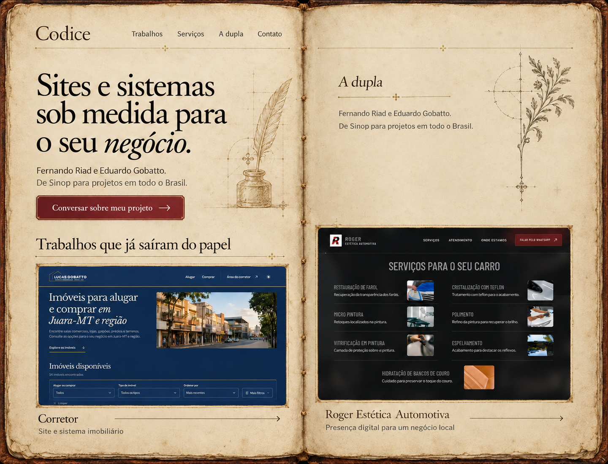
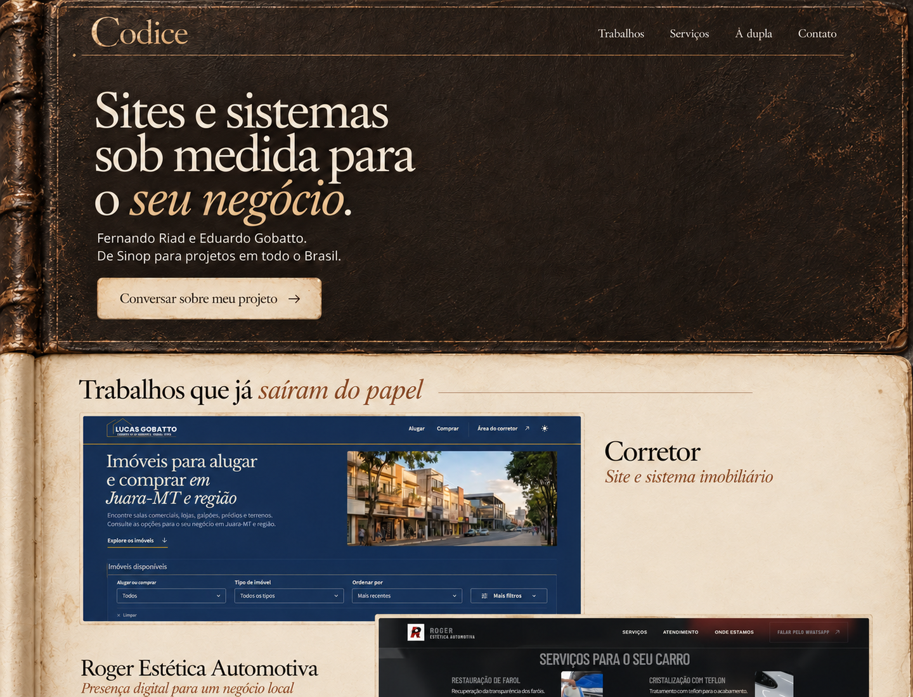
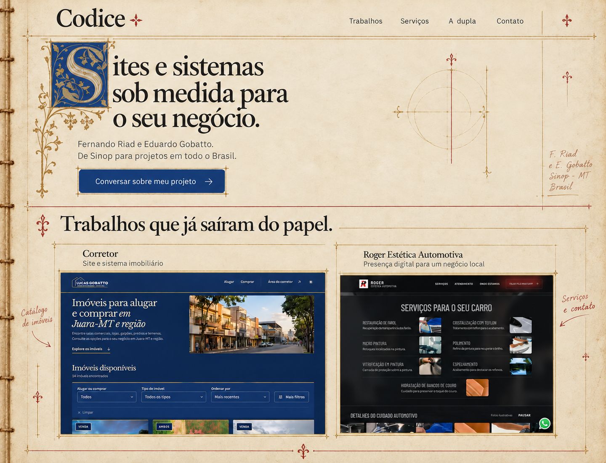

# Comparação visual da Codice

> **Acervo histórico — substituído em 18/10/2026.** A identidade de livro antigo foi abandonada. A comparação vigente é Forma, Fluxo e Ritmo em `/estudo/`, documentada em [../study-2026-10-18/README.md](../study-2026-10-18/README.md). Aprovações, PNGs gerados e resultados abaixo pertencem à etapa de 17/10; não aprovam nem validam as novas prévias. O texto original e a provenance foram preservados. Roger passa a ser identificado como projeto demonstrativo, desenvolvido para um prospect que desistiu sem contrato; não é cliente contratado nem case de resultado.

## Escolha e implementação — 17/10/2026

A proposta **2. Encadernação escura** foi escolhida explicitamente: “Pode escolher por mim e seguir com a 2”. A aprovação está registrada no sidecar de `.impeccable/mocks/02-encadernacao-escura.png`, com `approved: true`. As imagens das outras duas direções e o painel continuam preservados como registro da comparação.

A landing estática foi implementada em Astro 7.4/Tailwind CSS 4, com preview em `http://localhost:4321`. A passagem da capa escura com lombada para o fólio claro e a composição assimétrica dos projetos orientam a página; serviços, suporte local, dupla e contato prolongam esse sistema com menor peso visual. Consulte [DESIGN.md](../../DESIGN.md) e o [estado atualizado do briefing](brief.md).

Os WOFF2 locais e as licenças estão documentados em [fonts.md](fonts.md). Capa, papel e fundo do CTA são novos materiais limpos gerados com `image_gen.imagegen`, em `public/images/`; as capturas de Corretor e Roger foram convertidas dos originais para WebP. As miniaturas eventualmente reinterpretadas nas propostas não foram usadas na landing como evidência dos projetos.

WhatsApp: Fernando `5566999356646`; Eduardo `556684184488`, sem adicionar dígito ao número informado. O domínio final permanece pendente; `SITE_URL` condiciona as URLs públicas e o sitemap do build.

O build de produção concluiu na implementação. A validação da landing em navegador está em andamento; a inspeção dos conceitos abaixo não é usada como prova de responsividade, acessibilidade ou funcionamento da página implementada.

## Registro histórico — comparação antes da escolha

O texto abaixo preserva a primeira entrega de 17/10/2026. Suas perguntas de avaliação e a espera por seleção descrevem aquele momento anterior à aprovação expressa e à implementação.

Primeira etapa do plano aprovado em 17/10/2026: escolher a composição antes de implementar a landing.

## Propostas

As três propostas individuais têm 1440 × 1100 px. O painel de comparação mantém a ordem abaixo, da esquerda para a direita.

| 1. Fólios abertos | 2. Encadernação escura | 3. Manuscrito de projetos |
| --- | --- | --- |
|  |  |  |

[Abrir comparação lado a lado](proposals/comparacao.png).

## Como avaliar

- Qual composição representa melhor a Codice?
- A oferta de sites e sistemas e a ação de contato estão claras?
- Há elementos de outra proposta que devem ser preservados?

## Referências e limites das imagens

As propostas foram produzidas com a ferramenta nativa `image_gen.imagegen`. Os prompts estão em [prompts.json](prompts.json); ajustes de texto e informações dos arquivos acompanham as propostas nos sidecars da pasta `.impeccable/mocks/`.

As imagens são estudos da futura página, não telas de uma implementação funcional. O gerador pode reinterpretar detalhes pequenos das miniaturas de portfólio; a evidência fiel dos trabalhos são as [capturas originais e suas fontes](references/sources.md). A implementação deve utilizar os arquivos originais das capturas, sem recriar as interfaces com IA.

As capturas de Corretor vieram do ambiente de teste público documentado. As fotografias do site Roger são identificadas pelo próprio projeto como ilustrativas. A seleção da Codice não implica prometer resultados comerciais dos projetos.

## Próxima etapa

Aguardar a escolha do usuário. Depois, registrar a referência escolhida e implementar a landing conforme o [briefing](brief.md). Número de WhatsApp e domínio continuam pendentes para finalizar o contato e preparar publicação.
